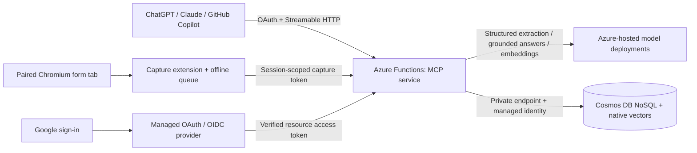

# Implementation architecture

## Components

The implementation uses Node.js 22, TypeScript, Express, and the official MCP TypeScript SDK. Each HTTP request gets a fresh MCP server and transport bound to its verified actor. Cosmos DB holds all durable workflow state; the Function App requires neither process affinity nor a persistent MCP session. The extension calls a separate capture API through the same Functions proxy.

## Generic storage

`infra/main.bicep` defines the Azure account and container policies. `db:initialize` verifies those policies; for the local emulator it creates the containers. No document schema is dedicated to health, education, work, or a particular family role.

| Record | Role |
|---|---|
| `vault` metadata | Owner identity hash, active flag, revision and maintenance barrier |
| `identities` container | Verified issuer/subject hash mapped to one vault; writable only by administrators |
| `entities` | Stable identities for remembered things; people are subjects |
| `claims` | Subject, predicate, JSON value or referenced entity, domain, qualifiers, validity interval, modality, revision, and search representation |
| `sources` | Original statement or finalized form text, original timestamp/timezone, and redaction status |
| `claim_evidence` | Exact source/value spans and the relation `supports`, `corrects`, `ends`, `retracts`, or `context` |
| `form_sessions` | Subject, exact website origin, capture secrets, completion and submission status, and snapshot checkpoint |
| `form_fields` / `form_revisions` | Latest draft values and ordered, idempotent field revisions |
| `proposals` | Concrete, expiring edit/deletion plans, their preview, client binding, and decision state |
| `operations` | Opaque request UUIDs, processing leases, completed responses, and content-free forgotten-request tombstones |
| `field_tombstones` | Opaque session/field identifiers blocking old queued events |
| `deletion_receipts` | Opaque identifiers needed to prevent replay and reapply deletion after restore |

Entity kinds, predicates, domains, values, and qualifiers are data. A small alias normalizer handles common identity terms; the service-owned model reuses known meanings and can introduce new ones. JSON supports arbitrary domain values inside a stable envelope: `{id, vault_id, kind, data, embedding?}`. Vectors live outside `data` and are excluded from ordinary reads and responses. The `vaults` container partitions every record kind by `/vault_id`; the separate identity directory partitions by `/id`. Relationship integrity is enforced by scoped service operations.

## Identity and isolation

The pilot defaults to Google federation through Microsoft Entra External ID, with pre-registered OAuth clients. The service can verify another managed issuer with equivalent claims, but the supplied deployment procedure uses External ID. It never implements a password store or a custom authorization server.

Access tokens require a trusted issuer and JWKS, the configured API audience, expiration, an identified client, and `memory.access`. Entra `oid` is used where available because it is stable across client registrations; otherwise the verified `sub` is used. Email is not an account-linking or authorization key. An administrator explicitly invites that issuer/subject pair.

The runtime identity can read the identity directory and read/write the memory container, with container-scoped Cosmos data-plane roles. It cannot create invitations. Administrative tooling uses a separate Entra principal. Production disables account-key authentication and public database networking; a private endpoint and private DNS connect the Function VNet to Cosmos. Local-only emulator keys are refused for public endpoints and production configuration.

Cosmos does not provide PostgreSQL-style row-level security. Vault isolation is a trusted service boundary: the verified issuer/subject maps to a vault, its ownership/active flag is checked, and every memory point read/query/batch supplies that full partition key. Query predicates additionally constrain `vault_id`; graph references are resolved inside that vault. No MCP tool accepts executable queries, raw partition selectors, or arbitrary mutations. A compromised backend identity could access the memory container; separate accounts are needed if infrastructure-level isolation per owner is required.

## Consistency and bounded commits

The Azure account uses Strong consistency. Every unit of work reads the vault metadata ETag, buffers scoped document changes, and commits with an `If-Match` metadata replacement in the same transactional batch. Concurrent writers retry their service callback against fresh records; callbacks perform no model calls or external effects. Read units recheck the metadata ETag before returning so multiple document queries cannot silently combine inconsistent revisions. Memory mutations advance a revision that is checked again after answer generation.

Cosmos batches are limited to 100 operations and 2 MB. Ordinary commits use at most 98 record changes plus metadata. Larger changes first atomically store an immutable, gzip-compressed write-ahead journal and a metadata maintenance barrier. Chunks conditionally apply records and advance a cursor; the final chunk removes the journal and barrier. Every vault request must finish pending maintenance before reading records. This provides application-visible all-or-nothing behavior even if a Function dies between chunks; it is not a cross-batch Cosmos transaction. Long recovery returns a retryable error without exposing partial data. Size validation happens before the barrier is installed. Journals and pending plans use bounded decompression. A corrupt/missing journal fails closed for administrative repair.

Journal payloads are excluded from indexing and contain the intended replacements, not a backup of the old records. Forget journals contain redacted records and tombstones; completing recovery removes the journal. Queries outside this service (for example, an administrator directly inspecting Cosmos) can see intermediate chunks and must respect the maintenance barrier.

## Write and approval flow

1. Reserve an opaque operation UUID before making model calls. Repeated requests return their completed result or a bounded processing lease.
2. Read bounded, vault-local context and invoke Azure structured extraction. Values and qualifiers travel as JSON strings inside a fixed wire schema, then receive domain validation.
3. Require verbatim source quotations and sensitive-value spans. Reject unresolved/cross-vault references, malformed values, and invalid date intervals. Semantic interpretation still depends on model quality; a quote is evidence of what was asserted, not independent truth verification.
4. Re-read affected subject/predicate tuples outside the model’s context window. A missing old fact in an LLM context cannot authorize an automatic replacement.
5. Generate embeddings in one batch before the transaction. Verify the vault revision again under a conditional metadata write, and commit the source, claims, evidence, and operation result through the bounded commit protocol.
6. New independent information saves immediately. Any potential replacement or explicit correction/retraction produces an immutable proposal. The whole source operation stays pending if it contains an edit.
7. The originating client relays the user’s approval or rejection for that proposal. A fully specified direct instruction already counts as approval. A broader or inferred change needs an additional question. The server never accepts a replacement payload at approval time.

Proposals expire after 15 minutes and bind to the owner, OAuth client, affected versions, and vault revision. Form proposals also bind to the form revision. A changed revision requires a new preview. The selected chat-mediated channel trusts the authorized client to relay human intent; it does not cryptographically prove a human conversation.

All model work occurs outside store callbacks. Model failures never return a saved acknowledgement. Failed operations release their processing lease for retry; a crashed worker’s lease expires after two minutes. Duplicate extracted facts share a claim while retaining their separate source spans.

## Time and history

`valid_from` and `valid_to` express when a claim applies. `recorded_at` and `superseded_at` express when it was recorded or superseded. Calendar dates are preserved as dates instead of converting through local-midnight timestamps.

A correction marks the mistaken assertion as corrected and reuses its correction lineage. A real life transition retains the prior period as historical and starts a separate lineage for the new period. Retractions retain their own evidence. Corrected/retracted assertions are excluded from ordinary recall; they are available only through an explicit revision-history request. Future plans and uncertainty are retained as modality, not silently promoted to completed events.

## Recall and memory levels

Recall combines indexed Unicode-normalized keyword-token candidates and same-version native cosine vector candidates with reciprocal-rank fusion, then walks entity relationships up to two steps. Cosmos queries are built and parameterized by the service; the model does not generate executable queries. Keyword matching uses indexed exact tokens, not stemming or BM25. DiskANN is approximate; exact keyword and graph candidates complement semantic search. Optional date/domain filters apply to the resulting claims. A bounded result reports truncation.

The service sends selected records and source quotations to the Azure model for an answer. Returned citation IDs must belong to the retrieved set. A final vault-revision check rejects an answer if a mutation occurred during generation. Only the cited claims, their evidence, and relevant entities are returned to the caller.

L0, L1, and L2 are generated views with different presentation depth, not separate stores or expiration classes. L2 remains the authority for exact form values. There is no persistent summary cache that can outlive corrections or forgetting. Calculated answers cite their basis and are not automatically saved as facts.

Default limits are 100 extracted claims per request, 100,000 source characters, 500 interpretation claims, 1,000 interpretation entities, 1,000 affected existing tuples, 80 ranked seeds, and 200 graph-neighbor claims. Documents retain source and claim text; indexed keyword lists are capped at 2,000 unique tokens per claim. embedding input is capped at 6,000 UTF-8 bytes per claim. Whole-scope administrative changes are bounded to 50,000 records and a 32 MiB decompressed / 1.75 MB encoded journal; individual mutations are capped below the 2 MB Cosmos item limit. Larger requests fail before saving any change. Each vault has Cosmos’s 20 GB logical partition limit; larger vaults require a deliberate partition redesign.

## Form lifecycle

An explicit `start_form` creates a draft for an existing subject and exact website origin. A 10-minute, one-use pairing code exchanges for a 24-hour token that can access only that form’s capture endpoints. Tokens contain opaque vault/session routing identifiers and random 256-bit entropy; only the full token’s hash is stored. No cross-partition secret lookup is needed. A new pairing revokes the previous capture token.

The extension requests site access only after a user action and binds to one tab/origin. It captures standard controls, same-origin frames, and open shadow roots. It records field values on events and periodic scans rather than every keystroke. Stable opaque field keys, event UUIDs, per-device sequence numbers, and server revisions support reconnects and duplicate delivery.

Draft revisions remain outside reusable personal memory. Finalization requests a fresh browser snapshot, waits for queued uploads, and checkpoints the form revision. Any later field mutation invalidates the checkpoint. The service then interprets final field values, retaining each field’s meaning, subject, form context, and evidence spans. Finalization and website submission are separate; the server never submits forms.

The extension has a persistent local queue capped at 5,000 events and an explicit overflow/error state. Pairing credentials live in session storage. Browser restarts require re-pairing the existing draft before buffered entries can upload. Only one capture binding is active at a time.

## Forgetting and restore

Deletion previews include the selected correction lineages and affected records. Applying them removes claims and embeddings, redacts their known source/value spans, updates surviving quotations, removes linked/recognized form fields and revisions, and clears pending proposal content. If a forgotten name was copied into its subject’s display label, known label references are redacted as well. Search text avoids copying entity names into every unrelated fact.

All in-flight/completed write UUIDs affected by the vault invalidation become content-free tombstones. A stale retry cannot reintroduce forgotten content. Capture-field tombstones similarly reject old browser events; the extension removes corresponding queue entries on its next successful sync. A deliberate new user request can reintroduce information using a new UUID or form session.

Deletion is based on selected claim lineages and tracked source representations. It cannot discover every arbitrary paraphrase or classify every unknown draft field with certainty. `discard_form` provides an explicit way to remove an entire unclassified form; it removes facts only when that form supplied their last evidence. Clients must preview and approve the full scope rather than equate a narrower request with permission for broader deletion.

Receipts contain opaque identifiers, not forgotten values or text hashes. They must be exported independently of database backups. Restore serving stays disabled until those receipts are replayed and verified. Offline browser buffers purge on their next sync; previously delivered conversations and third-party websites are outside this boundary. See `docs/restore.md`.

## Deployment and validation boundaries

The Bicep template provisions Flex Consumption hosting, a single-region Cosmos serverless account with Strong consistency and native vector indexing, private endpoint/DNS/VNet, deployment storage, and scoped managed-identity access to Cosmos and an existing Azure OpenAI account. It uses seven-day continuous backups. No PostgreSQL server, database password, or new Key Vault is provisioned. Models and the Google-federated identity tenant remain external prerequisites. Default region is `centralus`; the existing model deployment’s processing geography must be selected deliberately.

Local tests use the official Cosmos vNext emulator, a real MCP SDK client, and the actual unpacked Chromium extension. They exercise partition scoping, native vector queries, competing conditional batches, interrupted journal recovery, form checkpoints, forgotten-request protection, and receipt replay. Emulator authentication is not enforced; cloud RBAC/private DNS and production throughput must be verified in Azure. Azure model calls are contract-tested with controlled responses; actual model quality, Google federation and signed-in product integrations still need target-environment validation.

Serverless removes provisioned database compute but does not promise lower cost for every workload. Strong reads, vector queries, source/evidence fan-out, maintenance recovery, and storing form revisions consume RUs. DiskANN falls back to a scan below its indexing threshold, and serverless is capped per physical partition. Track request units, 429s, latency, stored revisions and per-vault growth; private endpoint/DNS, host storage, backup restores and model calls are separate cost items. See [Cosmos decision](adr/0004-cosmos-serverless-memory-store.md).
